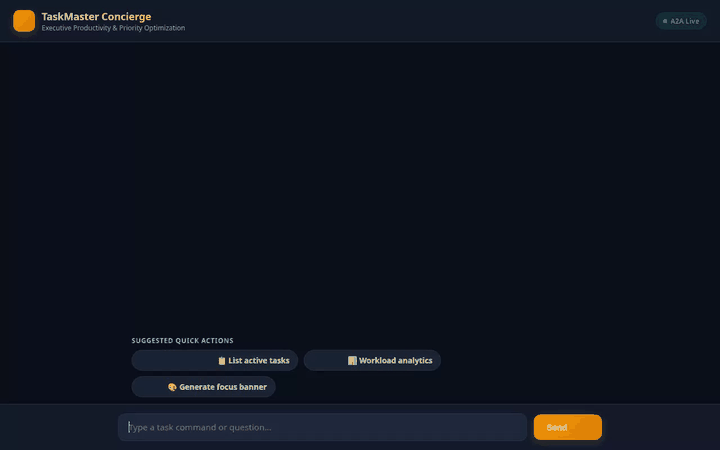

# TaskMaster Concierge

An executive AI assistant built with Google Agent Development Kit (ADK), specializing in task management, Eisenhower Matrix priority optimization, workload analytics, cross-session persistent memory, visual artifact generation, and rich A2UI rendering.



---

## 🌟 Capabilities & Features

### 📋 Executive Task Management & Firestore Integration
* **Persistent Database Storage**: Task state is persisted directly in Google Cloud Firestore (`taskmaster_tasks` collection).
* **Eisenhower Matrix Priority Optimization**: Tasks are automatically categorized into Urgent vs. Strategic priority levels (`list_tasks`, `add_task`, `update_task_priority`, `complete_task`).
* **Cross-Session Memory Bank**: Powered by Vertex AI Memory Bank (`PreloadMemoryTool` & memory callbacks), allowing the agent to remember user preferences and past context across separate chat sessions.

### 📊 Sandboxed Workload & Analytics
* **Sandboxed Code Execution**: Uses `AgentEngineSandboxCodeExecutor` for secure, isolated Python data processing to compute workload hours, Eisenhower distributions, and burnout risk metrics (`calculate_workload_analytics`).

### 🎨 Visual Artifact & Video Generation
* **AI Image Generation**: Generates visual task badges (`generate_task_artifact_image`) using `gemini-3.1-flash-lite-image` and daily strategic focus banners (`generate_focus_banner`) using `gemini-2.5-flash-image`.
* **Omni Video Generation**: Generates short video summaries (`generate_task_artifact_video`) using Google's Omni model (`gemini-omni-flash-preview` in the `global` region).
* **Public Asset Hosting**: Artifacts are saved to ADK session context and uploaded directly to a public Google Cloud Storage bucket.

### 🧩 Native A2UI Interface Rendering
* **Schema & Catalog Support**: Built using `A2uiSchemaManager` (version 0.8) and `BasicCatalog`.
* **Structured UI Components**: Renders responses as structured native UI elements (`Card`, `Column`, `Row`, `Text`, `Image`) via `after_model_callback`.

### 🌐 Real-Time External Integrations
* **Daily Executive Quotes**: Fetches daily mindset and productivity quotes via the ZenQuotes API (`fetch_daily_quote`).
* **Calendar Holiday Planning**: Looks up upcoming public holidays via Nager.Date API (`fetch_upcoming_holidays`).

---

## 🏗️ Architecture & Technology Stack

| Component | Technology / Service |
| :--- | :--- |
| **Agent Framework** | Google Agent Development Kit (ADK) |
| **Foundation Model** | Gemini Flash (`gemini-flash-latest`) |
| **Image Generation** | Gemini 3.1 Flash Lite Image & Gemini 2.5 Flash Image |
| **Video Generation** | Gemini Omni Flash Preview (`gemini-omni-flash-preview` in `global`) |
| **Database** | Google Cloud Firestore |
| **Asset Storage** | Google Cloud Storage (GCS) |
| **Memory Service** | Vertex AI Memory Bank |
| **Code Execution** | Agent Engine Sandbox Code Executor |
| **Protocol & UI** | A2A Protocol & A2UI (v0.8 Basic Catalog) |
| **Frontend Proxy** | FastAPI & Uvicorn |

---

## 🚀 Local Setup & Running Instructions

### Prerequisites
* Python 3.11+
* Google Cloud CLI (`gcloud`) authenticated with Google Cloud project credentials.

### 1. Environment Configuration
Ensure your Google Cloud credentials and project variables are set:
```bash
export GOOGLE_CLOUD_PROJECT="<your-gcp-project-id>"
export GOOGLE_GENAI_USE_VERTEXAI="true"
export GOOGLE_CLOUD_LOCATION="us-central1"
```

### 2. Install Agent Dependencies
Navigate to the project root directory and set up the virtual environment:
```bash
python3 -m venv .venv
source .venv/bin/activate
pip install -r requirements.txt
```

### 3. Run the Agent Locally via CLI
Test agent tools and interactions locally:
```bash
agents-cli run "List my active tasks"
```

### 4. Run the Web Frontend & Proxy Locally
Navigate to the `frontend/` directory, install frontend dependencies, and start the FastAPI proxy server:
```bash
cd frontend
pip install -r requirements.txt
export AGENT_ENGINE_RESOURCE_NAME="<your-agent-engine-resource-name>"
export AGENT_DIRECTORY="app"
python main.py
```
*The web interface will be accessible on your local port (default 8080).*

---

## ☁️ Cloud Deployment Instructions

### Deploy Agent to Agent Runtime (Reasoning Engine)
```bash
agents-cli deploy --region us-central1 --project <your-gcp-project-id>
```

### Deploy Frontend to Cloud Run
```bash
gcloud run deploy taskmaster-frontend \
  --source ./frontend \
  --region us-central1 \
  --set-env-vars AGENT_ENGINE_RESOURCE_NAME="<your-agent-engine-resource-name>",AGENT_DIRECTORY="app" \
  --allow-unauthenticated
```
